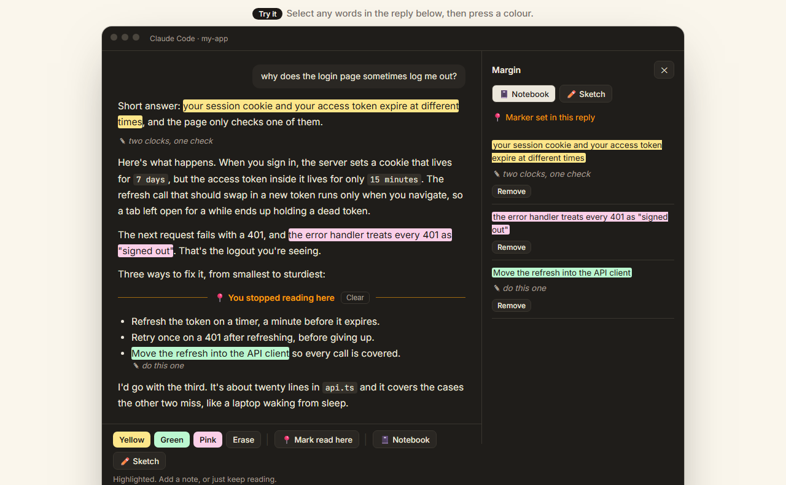
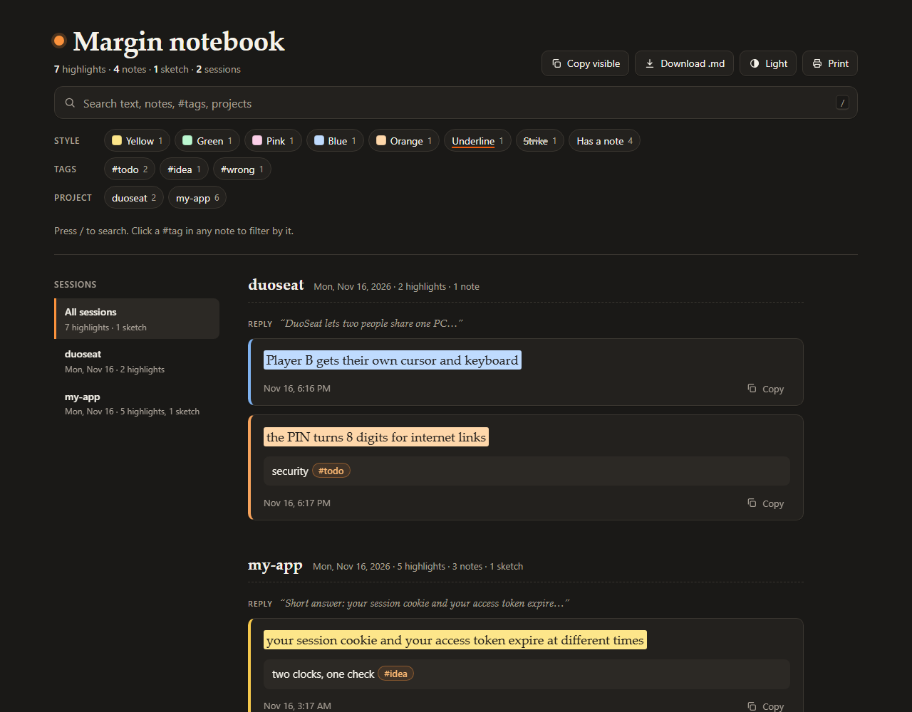

<p align="center"></p>

<h1 align="center">Margin</h1>
<p align="center"><b>Claude writes a lot. Mark what matters.</b></p>
<p align="center">A free highlighter, notes and "read up to here" marker for Claude Code &nbsp;·&nbsp; <a href="https://margin.wedevit.in">margin.wedevit.in</a> (try it in the browser)</p>



Long replies are great until you lose your place, or can't find the one line that mattered. Margin adds a pen and a bookmark to Claude Code:

- **Highlight** any part of a reply in yellow, green, pink, blue or orange, or mark it with an underline or a strike. Bold, italics and code keep their look.
- **↶ Undo** your last change, any time.
- **Pin a note** to a highlight. It shows under the paragraph.
- **📍 Mark read here** drops a marker where you stopped. **Resume** shows everything after it. **Clear** takes it off.
- **✏️ Sketch here** opens a drawing pad right under the reply, in the chat. Pick an ink, draw, Save, and the sketch stays under that reply. Strokes are smoothed into clean SVGs with [perfect-freehand](https://github.com/steveruizok/perfect-freehand).
- **❝ Quote** drops what you selected into the prompt, so you can ask Claude about exactly that.
- **📓 Notebook** keeps it all, per session or across every session. Search it, filter by colour, copy it as Markdown, and browse it as a web page.
- **Hide it** when you don't need it. The row folds down to one small button.

Works in the **Claude desktop app (Code tab)** and in **the terminal**. Everything stays on your computer.

## Install (about a minute)

You need [Claude Code](https://claude.com/claude-code). Then, in a terminal:

```bash
claude plugin marketplace add basithladdu/margin
claude plugin install margin@margin
```

Or at the prompt of a terminal Claude Code session (say **y**, then pick a scope):

```
/plugin install margin --marketplace basithladdu/margin
```

Start a new session (in the desktop app too). The Margin row shows up above the prompt.

> Mods are a new part of Claude Code. If the row doesn't appear, update Claude Code (`claude update`) and start a new session.

## How to use it

| You want to | Do this |
|---|---|
| Highlight | Select text in a reply, press a colour (keys `1` to `5` while the row has focus) |
| Add a note | After highlighting, type in the **Note** field and press Enter |
| Remove a highlight | Select it and press **Erase**, press the same colour again, or **Remove** in the notebook |
| Mark where you stopped | Select a word in the reply you stopped at, press **📍 Mark read here** |
| Pick up again | **Resume** shows the replies after your marker |
| Remove the marker | **Clear** on the marker line, or **Clear mark** above the prompt |
| Ask Claude about a bit | Select it, press **❝ Quote**, type your question |
| See everything | **📓 Notebook**, or type `/margin`. Search, filter by colour, **Copy as Markdown** |
| Hide the row | The **✕** at the end of the row, or `/margin hide`. Bring it back with **🖍 Margin** or `/margin show` |
| Draw under a reply | Select a word in it, press **✏️ Sketch here**, drag, **Save** |
| Undo | **↶ Undo**, `u`, or `/margin undo` |
| Know what's new | **Resume (3 new replies)** counts what came after your marker |

## Settings

Change these in Claude Code's config (`/config`, or `pluginConfigs` in `~/.claude/settings.json`):

| Setting | What it does | Default |
|---|---|---|
| `rowStyle` | `full` shows words on the buttons, `compact` shows icons only | `full` |
| `startHidden` | Start with the row folded into one small button | off |
| `notebookFolder` | Where the notebook files go | `Documents/Margin Notebook` |
| `saveNotebook` | Write the HTML and Markdown notebook at all | on |
| `autoMark` | Sending a message moves your marker to the latest reply | off |

## Where your stuff lives

All of it is local. Nothing is sent anywhere.

- Claude Code keeps Margin's data in its own plugin store on your machine.
- Every change is also written to **`Documents/Margin Notebook/`**:
  - `index.html`: your notebook. Open it in any browser: search with `/`, filter by colour, #tag or project, copy or download as Markdown, print, light or dark.
  - `notebook.md`: the same as Markdown. Point Obsidian or Logseq at the folder.
  - `sketches/*.svg`: one file per sketch.



## Honest list

- A paragraph with a highlight in it is redrawn by Margin. Bold, italics, code and headings keep their look, but links in that paragraph show as plain text.
- The desktop app doesn't let mods scroll the conversation, so **Resume** opens the rest of your reading in the side pane rather than jumping.
- Mods can't draw on top of the reply text itself, so the pad sits right under the reply. While drawing it uses braille dots (that's what the app lets a mod draw live); saved sketches come out smooth.
- Highlights are tied to the reply they were made on. Fork or rewind a conversation and older highlights may not follow.

## Build it yourself / hack on it

It's a [Claude Code mod](https://code.claude.com/docs): TypeScript files, no build step.

```
.claude-plugin/plugin.json      the manifest
.claude-plugin/marketplace.json makes this repo installable
hooks/register.tsx              the controls row, the redrawn replies, the notebook pane
hooks/marks.ts                  finding a selection inside a reply
hooks/sketch.tsx                the sketch pad (runs inside the pane)
hooks/notebook.ts, ink.ts       the notebook page and smooth SVG sketches
hooks/vendor/perfect-freehand/  MIT, by Steve Ruiz, unchanged
tests/                          claude plugin test .
site/                           margin.wedevit.in
```

Try a local copy without installing:

```bash
claude --plugin-dir ./margin
claude plugin validate ./margin
claude plugin test ./margin
```

See [CONTRIBUTING.md](CONTRIBUTING.md). Bugs and ideas: [open an issue](https://github.com/basithladdu/margin/issues).

## License

[MIT](LICENSE). perfect-freehand is MIT, © Stephen Ruiz Ltd (see `hooks/vendor/perfect-freehand/LICENSE`).

Also by us: [DuoSeat](https://github.com/basithladdu/duoseat), two people, one Windows PC, two cursors.
